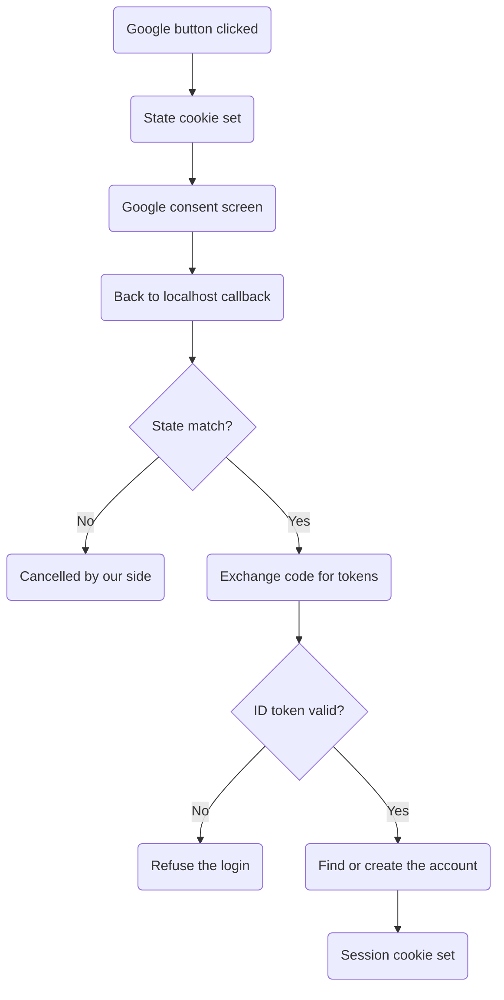

# Google sign-in — setup guide

The code is already built. This page is the one part only you can do: create the
key in your own Google account and paste it into `.env`.

Until you do, the Google button in the sign-in sheet stays honest and says
"not set up yet". Nothing else breaks.

---

## 1. Create the app in Google Cloud

1. Open <https://console.cloud.google.com/> and sign in with your Google account.
2. Top left: pick a project, or create one called `Marqueuet`.
3. Left menu: **APIs & Services** → **OAuth consent screen**.
   - User type: **External** → Create.
   - App name: `Marqueuet`, your email as support email, your email as developer contact.
   - Scopes: nothing to add by hand. The app asks only for `openid`, `email`,
     `profile` — a name and an email, never Gmail or Drive.
   - **Test users**: add the Google accounts that will sign in during the demo
     (yours, your professor's). While the app is in "Testing" mode, only these
     accounts can sign in. This is the demo-day trap — add them now.
4. Left menu: **APIs & Services** → **Credentials** → **Create credentials**
   → **OAuth client ID**.
   - Application type: **Web application**.
   - Name: `Marqueuet local`.
   - **Authorized JavaScript origins**: `http://localhost:3000`
   - **Authorized redirect URIs**: `http://localhost:3000/api/auth/google/callback`
   - The address must match exactly — no trailing slash, `http` not `https`.
5. Copy the **Client ID** and **Client secret** it shows you.

---

## 2. Put them in `.env`

Create or edit `Marqueuet/.env` (this file is already in `.gitignore`):

```
GOOGLE_CLIENT_ID=your-client-id.apps.googleusercontent.com
GOOGLE_CLIENT_SECRET=your-client-secret
```

Optional, if your server runs on another port:

```
GOOGLE_REDIRECT_URI=http://localhost:3000/api/auth/google/callback
```

Then restart the server. The button now works.

---

## How the flow works



- The **client secret** only ever lives on the server. The browser never sees it.
- The **state cookie** is a one-time random value. It stops a stranger from
  tricking someone into signing in to an account they did not choose.
- The **ID token** is checked before it is trusted: Google's signature,
  the issuer, that it was minted for your client ID, and that it is not expired.
- Google sign-in goes through the same **rate limiter** as the other ways in.
- A Google login with an email you already registered locally links to that
  same account, so nobody ends up with two.

---

## What the demo needs

| Thing | Why |
| --- | --- |
| Internet on the demo laptop | Google is an outside service |
| Both accounts added as test users | otherwise Google shows "app not verified" |
| Guest + local sign-in working first | backup when the venue Wi-Fi fails |

Slide line that keeps you safe: *"Google sign-in is live; if the network is
down, guest and local sign-in still work."*
